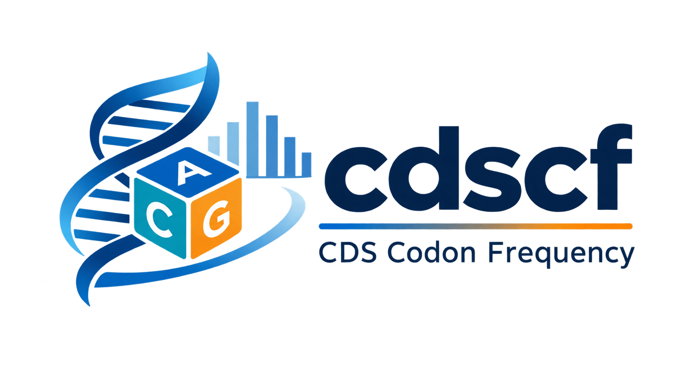

# cdscf

**CDS Codon Frequency**：使用 Rust 编写的编码区密码子频率分析工具包。

[](https://www.rust-lang.org/)
[](#许可证)

<div align="center">
  
</div>

`cdscf` 读取 NCBI GenBank 文件或 SnapGene DNA 文件，只提取注释为 **CDS** 的编码序列，统计 64 种标准 DNA 密码子的数量和相对频率。非编码区、启动子、内含子及其他非 CDS 特征不会进入统计。

提供 Windows 图形界面、独立的命令行工具和 Rust 库三种使用方式，可集成到不同的生物信息学分析流程中。

## 功能特性

- 支持 NCBI `.gbff`、`.gb`、`.gbk` 文件
- 支持 SnapGene 二进制 `.dna` 文件
- 自动识别输入格式，也可手动指定
- 支持 GenBank 多记录文件，并汇总所有记录的 CDS
- 支持简单、跨行和复合 CDS 位置：
  - `100..900`
  - `join(...)`
  - `order(...)`
  - `complement(...)`
  - `complement(join(...))`
  - 模糊边界，如 `<100..>900`
- 按 `/codon_start` 校正 CDS 阅读框
- 支持 SnapGene 多区段 CDS、互补链和环状序列跨原点区段
- 默认跳过 `/pseudo` 和 `/pseudogene` 标记的 CDS
- 输出全部 64 种标准密码子，包括计数为零的密码子
- 支持表格、CSV 和 JSON 三种输出格式
- Windows 图形界面支持文件拖放、后台分析、结果搜索与排序
- 按标准遗传密码表进行氨基酸分组，组内密码子默认按频率从高到低排列
- 独立的宿主密码子优化栏目：从宿主 CDS 选择每个氨基酸的最高频密码子
- 支持目的 DNA 密码子替换和蛋白质序列反向翻译，并可复制或导出 FASTA
- 图形界面和 EXE 文件均使用内置 cdscf Logo 与多尺寸图标
- 提供可复用的 Rust 库接口

## 统计规则

为了避免不同分析流程对“密码子频率”的定义产生歧义，`cdscf` 使用以下规则：

1. **只统计 CDS**：不会扫描整个基因组，也不会从非编码区推导开放阅读框。
2. **按编码方向读取**：互补链 CDS 会进行反向互补，多区段 CDS 会按注释顺序拼接。
3. **应用阅读框偏移**：`codon_start=1`、`2`、`3` 分别跳过 CDS 起始处的 0、1、2 个碱基。
4. **只统计完整三联体**：每个 CDS 末尾不足三个碱基的部分会被跳过并计入 `trailing_bases`。
5. **只统计标准 DNA 密码子**：由 `A`、`C`、`G`、`T` 组成的密码子进入频率统计；含 `N`、`R`、`Y` 等简并碱基的密码子会被跳过并计入 `ambiguous_codons`。
6. **默认包含终止密码子**：CDS 注释通常包含末端终止密码子，因此默认将 `TAA`、`TAG`、`TGA` 纳入统计。使用 `--exclude-stop` 可将所有终止密码子排除在计数和频率分母之外。
7. **默认排除伪基因**：可通过 `--include-pseudo` 改变此行为。
8. **多记录采用全局汇总**：当前输出是所有纳入记录的合并结果，而不是逐 CDS 或逐记录分别输出。
9. **氨基酸分类采用标准遗传密码表**：GUI 和导出结果中的氨基酸映射使用 `transl_table=1`，终止密码子以 `*` 表示。

密码子频率计算公式为：

```text
frequency(codon) = count(codon) / total_counted_codons
```

其中 `total_counted_codons` 不包含模糊密码子、不完整三联体，以及使用 `--exclude-stop` 时排除的终止密码子。

## 环境要求

- Rust 1.85 或更高版本
- 支持 Rust 2021 Edition 的 Cargo 工具链
- Windows 图形界面目标为 Windows 10 / 11 x64

如果尚未安装 Rust，请通过 [rustup](https://rustup.rs/) 安装。

## 安装

### 从源码构建

```bash
git clone https://github.com/YOUR_NAME/cdscf.git
cd cdscf
cargo build --release
```

构建完成后，可执行文件位于：

- Linux / macOS：`target/release/cdscf`
- Windows：`target/release/cdscf.exe`

### 安装到 Cargo 二进制目录

仅安装命令行工具：

```bash
cargo install --path .
```

同时安装命令行和图形界面：

```bash
cargo install --path . --features gui
```

安装后可直接运行：

```bash
cdscf --help
cdscf-gui
```

## Windows 图形界面

### 构建与运行

```bash
cargo build --release --features gui --bin cdscf-gui
```

Windows PowerShell 中运行：

```powershell
.\target\release\cdscf-gui.exe
```

也可以在开发时直接启动：

```bash
cargo run --release --features gui --bin cdscf-gui
```

### 图形界面功能

- 浏览选择或拖入 `.gbff`、`.gb`、`.gbk`、`.dna` 文件
- 自动识别输入格式，或手动选择 GenBank / SnapGene
- 设置是否纳入伪基因 CDS、是否排除终止密码子
- 在后台线程分析大文件，避免界面卡顿
- 显示记录数、CDS 数、有效密码子数和跳过项统计
- 展示全部 64 种密码子的氨基酸分类、计数、相对频率、每千密码子频率和相对强度
- 默认按氨基酸分组，并在每个组内按密码子频率从高到低排序
- 按密码子筛选，也可切换为全局密码子、计数或频率排序
- 将结果导出为 CSV、JSON 或文本表格

### 宿主密码子优化

切换到“宿主密码子优化”栏目后，按以下步骤操作：

1. 输入宿主菌的 GenBank 或 SnapGene 基因组文件，程序只根据宿主 CDS 计算密码子使用次数。
2. 输入目的 DNA 或单字母氨基酸序列，支持纯序列和 FASTA。
3. 选择序列类型；自动识别仅含 `A/C/G/T/U/N` 的输入为 DNA，其他输入为蛋白质。对于仅由这些字母组成的特殊蛋白质，请手动选择“蛋白质 / 氨基酸”。
4. 点击“分析宿主并优化序列”。

优化规则：

- 每个氨基酸使用宿主 CDS 中实际计数最高的同义密码子。
- 计数相同时，按密码子字母序选择前者，保证结果可重复。
- DNA 输入必须能被 3 整除，且不能包含简并碱基，以保证优化前后翻译不变。
- 蛋白质输入支持 20 种标准氨基酸和 `*` 终止符号；终止符号使用宿主最高频终止密码子。
- 如果宿主 CDS 中完全没有某个所需氨基酸的密码子，程序会明确报错，不会随意选择密码子。
- 优化结果可复制为连续 DNA 序列，也可导出为每行 60 bp 的 FASTA 文件。

Logo 已嵌入程序，无需随 EXE 额外携带图片文件。构建脚本还会尝试将 `assets/cdscf.ico` 和版本信息嵌入 Windows EXE。

## 命令行快速开始

### 分析 GenBank 文件

```bash
cdscf genomic.gbff
```

### 分析 SnapGene 文件并输出 CSV

```bash
cdscf genomic.dna --format csv --output codons.csv
```

### 输出 JSON 并排除终止密码子

```bash
cdscf genomic.gbff --format json --exclude-stop
```

### 直接通过 Cargo 运行

```bash
cargo run --release -- genomic.gbff --format table
```

Windows PowerShell 中直接使用项目内已构建的程序：

```powershell
.\target\release\cdscf.exe genomic.gbff
```

## 命令行选项

```text
cdscf [OPTIONS] <INPUT>
```

| 选项 | 说明 |
| --- | --- |
| `<INPUT>` | 输入的 GenBank 或 SnapGene 文件 |
| `-f, --format <FORMAT>` | 输出格式：`table`、`csv`、`json`，默认 `table` |
| `-o, --output <OUTPUT>` | 输出文件路径；省略时写入标准输出 |
| `--input-format <FORMAT>` | 输入格式：`auto`、`genbank`、`snapgene`，默认 `auto` |
| `--include-pseudo` | 纳入标记为 `/pseudo` 或 `/pseudogene` 的 CDS |
| `--exclude-stop` | 排除 `TAA`、`TAG`、`TGA`，不计入频率分母 |
| `-h, --help` | 显示帮助 |
| `-V, --version` | 显示版本 |

## 输出格式

### 表格

默认输出汇总信息和 64 行密码子频率表：

```text
记录数: 1
记录 ID: EXAMPLE
统计的 CDS 数: 2
跳过的伪基因 CDS 数: 0
有效密码子总数: 1200
跳过的模糊密码子数: 0
不足三联体的末端碱基数: 0
排除的终止密码子数: 0

CODON  AA         COUNT       FREQUENCY
AAA    K             25        0.02083333
AAC    N             18        0.01500000
...
```

以上数字仅用于展示输出结构。

### CSV

CSV 包含固定的四列表头，便于导入 R、Python、Excel 或其他分析工具：

```csv
codon,amino_acid,count,frequency
AAA,K,25,0.02083333
AAC,N,18,0.01500000
```

### JSON

JSON 同时包含记录 ID、CDS 数量、跳过项统计和 64 种密码子的结果：

```json
{
  "records": ["EXAMPLE"],
  "cds_features": 2,
  "skipped_pseudo": 0,
  "total_codons": 1200,
  "ambiguous_codons": 0,
  "trailing_bases": 0,
  "excluded_stop_codons": 0,
  "codons": [
    {"codon": "AAA", "amino_acid": "K", "count": 25, "frequency": 0.02083333}
  ]
}
```

实际输出会包含全部 64 种密码子。

## 作为 Rust 库使用

在另一个本地 Rust 项目中添加路径依赖：

```toml
[dependencies]
cdscf = { path = "../cdscf" }
```

示例：

```rust
use cdscf::{analyze_path, AnalyzeOptions, InputFormat};

fn main() -> cdscf::Result<()> {
    let options = AnalyzeOptions {
        include_pseudo: false,
        exclude_stop_codons: true,
    };

    let analysis = analyze_path("genomic.gbff", InputFormat::Auto, options)?;

    println!("记录数：{}", analysis.record_count());
    println!("CDS 数：{}", analysis.cds_features);

    for entry in analysis.stats.entries() {
        println!("{}\t{}\t{}\t{:.8}", entry.codon, entry.amino_acid, entry.count, entry.frequency);
    }

    Ok(())
}
```

宿主密码子优化也可以直接调用：

```rust
use cdscf::{analyze_path, optimize_sequence, AnalyzeOptions, InputFormat, SequenceKind};

let host = analyze_path("host.gbff", InputFormat::Auto, AnalyzeOptions::default())?;
let optimized = optimize_sequence(&host, "MKAV*", SequenceKind::Protein)?;
println!("{}", optimized.dna);
```

也可以在内存中解析输入：

```rust
let genbank_records = cdscf::parse_genbank(&bytes)?;
let snapgene_records = cdscf::parse_snapgene(&bytes)?;
```

主要公开类型和函数包括：

- `read_records`
- `parse_genbank`
- `parse_snapgene`
- `analyze_records`
- `analyze_path`
- `optimal_codons`
- `optimize_sequence`
- `OptimizedSequence`
- `SequenceKind`
- `Analysis`
- `AnalyzeOptions`
- `CodonStats`
- `CodonFrequency`
- `output::write_analysis`

## 开发与检查

```bash
# 检查格式
cargo fmt --all -- --check

# 运行核心测试
cargo test --all-targets

# 运行包含 GUI 目标的全部测试
cargo test --all-targets --features gui

# 运行 Clippy，并将警告视为错误
cargo clippy --all-targets --features gui -- -D warnings

# 构建命令行优化版本
cargo build --release

# 构建 Windows GUI 优化版本
cargo build --release --features gui --bin cdscf-gui
```

项目结构：

```text
cdscf/
├── Cargo.toml
├── build.rs        # Windows 图标与版本资源
├── README.md
├── assets/
│   ├── cdscf_logo.png
│   ├── cdscf_icon.png
│   └── cdscf.ico
└── src/
    ├── lib.rs        # 公共库接口与输入格式识别
    ├── main.rs       # 命令行入口
    ├── gui.rs        # Windows 图形界面与栏目导航
    ├── optimizer_gui.rs # 宿主密码子优化栏目
    ├── optimize.rs   # 最高频密码子选择与序列优化
    ├── genbank.rs    # GenBank 解析器
    ├── snapgene.rs   # SnapGene 解析器
    ├── location.rs   # GenBank 位置表达式与反向互补
    ├── stats.rs      # CDS 筛选和密码子统计
    ├── output.rs     # 表格、CSV、JSON 输出
    ├── model.rs      # 数据模型
    └── error.rs      # 错误类型
```

## 当前限制

- GenBank 记录必须包含可用的 `ORIGIN` 序列；不会根据 `CONTIG` 或远程登录号自动下载序列。
- 不支持引用其他记录的远程位置，例如 `ACCESSION.1:100..900`。
- SnapGene 文件必须包含 DNA 序列块；蛋白质序列文件不在支持范围内。
- 当前输出为所有 CDS 的全局汇总，暂不支持逐基因、逐 CDS 或逐记录输出。
- 不预测新的 CDS，也不校验注释中的 `/translation` 是否与提取序列一致。

## 贡献

欢迎提交 Issue 和 Pull Request。报告解析问题时，建议附上：

- 输入格式及软件来源
- 可公开分享的最小复现文件
- 完整错误信息
- 预期结果与实际结果

提交代码前请运行格式检查、测试和 Clippy。

## 许可证

本项目采用 [MIT License](https://opensource.org/licenses/MIT)。
